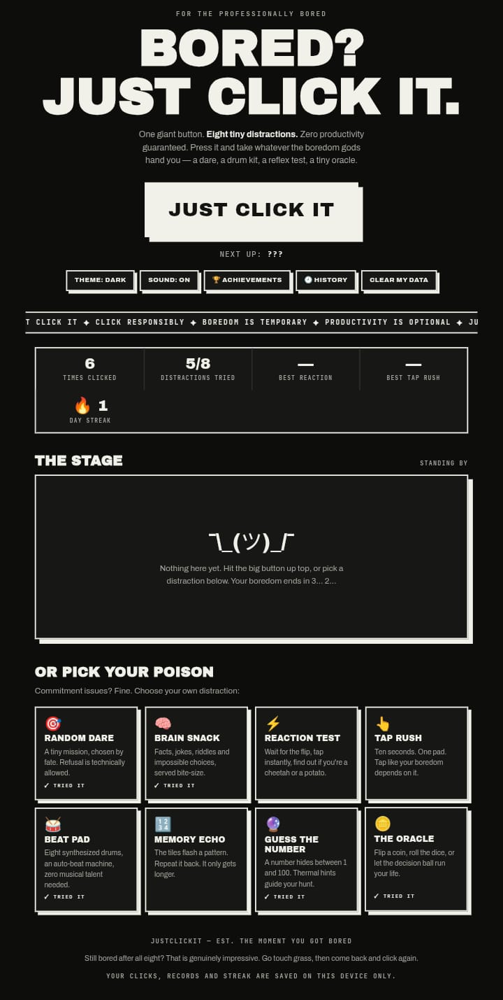

# JustClickIt

**One giant button. Nine tiny distractions. Zero productivity guaranteed.**

[](https://unformalecho.github.io/JustClickIt/)
[](https://github.com/unformalecho/JustClickIt/actions/workflows/deploy.yml)
[](https://vite.dev/)
[](https://www.typescriptlang.org/)
[](https://unformalecho.github.io/JustClickIt/)

**[▶ Try it live: unformalecho.github.io/JustClickIt](https://unformalecho.github.io/JustClickIt/)** — no install, no account, no ads.

JustClickIt is a monochrome, neobrutalist web app for bored people. Press the big
button and take whatever the boredom gods hand you — a dare, a drum kit, a reflex
test, a tiny oracle. All in English, all client-side, all on your device.

[](https://unformalecho.github.io/JustClickIt/)

## Table of contents

- [The nine distractions](#the-nine-distractions)
- [What you get](#what-you-get)
- [Run it locally](#run-it-locally)
- [How it is deployed](#how-it-is-deployed)
- [Data & privacy](#data--privacy)
- [Project layout](#project-layout)
- [Content note](#content-note)
- [Roadmap](#roadmap)

## The nine distractions

| #   | Game             | What it does                            |
| --- | ---------------- | --------------------------------------- |
| 1   | Random Dare      | 24 missions, no take-backs              |
| 2   | Brain Snack      | Facts, jokes, riddles, Would You Rather |
| 3   | Reaction Test    | Wait for the flip, tap instantly        |
| 4   | Tap Rush         | 10 seconds, as many taps as possible    |
| 5   | Beat Pad         | 8 Web Audio drums + auto-beat sequencer |
| 6   | Memory Echo      | Simon-style pattern game                |
| 7   | Guess the Number | 1–100 with thermal hints                |
| 8   | The Oracle       | Coin flip, dice roll, decision ball     |
| 9   | Mini Chess       | 6×6 chess vs AI — Chill or Unsolvable   |

You can also pick any distraction straight from the grid — the button is only
for when you cannot decide.

## What you get

- **Persistent progress.** Clicks, best scores, play history, theme and sound
  settings survive reloads (see [Data & privacy](#data--privacy)).
- **12 achievements** with toasts: First Click, Explorer (4 distractions),
  Completionist (all 9), Lightning (reaction < 180 ms), Fast Fingers (Tap Rush
  ≥ 70), Echo Master (Memory Echo level 8), Lucky Guesser (≤ 4 guesses),
  Beatmaker, Oracle Believer, Chess Master (win a game of Mini Chess),
  3-Day Streak, 7-Day Streak.
- **Daily streak** shown in the stats bar.
- **Light / dark / system theme** and a sound toggle.
- **Deep links.** Every view has a hash route (`#/games`, `#/game/mini-chess`,
  `#/stats`, `#/achievements`, `#/settings`, `#/about`) — refreshing keeps
  your place instead of returning to Home.
- **Self-hosted fonts** (Archivo, Archivo Black, JetBrains Mono) — the site
  makes zero requests to third parties at runtime.

## Run it locally

Requires **Node.js 22+** and npm.

```bash
npm ci
npm run dev      # local dev server (http://localhost:5173)
npm run build    # type-check + production build into dist/
npm run preview  # serve the production build locally
```

| Script             | What it does                               |
| ------------------ | ------------------------------------------ |
| `npm run dev`      | Vite dev server                            |
| `npm run build`    | `tsc -b && vite build`                     |
| `npm run preview`  | Serve `dist/` (used by the e2e tests)      |
| `npm test`         | Vitest unit tests (88 tests)               |
| `npm run test:e2e` | Playwright smoke tests (Chromium + mobile) |
| `npm run lint`     | ESLint                                     |
| `npm run format`   | Prettier (write)                           |

## How it is deployed

The site is deployed to **GitHub Pages** from `main` via
`.github/workflows/deploy.yml` (checkout → download self-hosted fonts →
`npm ci` → `npm run build` → deploy `dist/`). Every push to `main` redeploys.

- **Live URL:** `https://unformalecho.github.io/JustClickIt/`
- **Base path:** Vite `base` is `/JustClickIt/` (repo name). The PWA manifest,
  fonts and asset URLs all use the same base — do not change it to `/` unless
  the repo is renamed or a custom domain is added.
- **Repo must be public** for free GitHub Pages. A private repo needs a paid
  plan; if the code must stay private, revisit this decision.
- There is **no server** on the host. Everything is static + client-side.

## Data & privacy

- All progress is stored **locally** in `localStorage` under the key
  `justclickit:v1` (versioned, validated on load). Corrupt data is backed up
  to `justclickit:v1:corrupt:<timestamp>` and the app starts fresh — it never
  crashes on bad stored data.
- Stored: total clicks, distractions tried, best scores (Reaction, Tap Rush,
  Memory Echo, Guess the Number), play history (last 50), achievements,
  daily streak, theme/sound settings, and an anonymous device ID (created
  once, reserved for a future leaderboard — no account, no login).
- **Clear my data** (in the app toolbar) wipes everything after a confirm.
- No analytics, no tracking, no network requests except the self-hosted fonts
  (which are served from this same site).

## Project layout

```
index.html                  # shell markup + meta (title/description only)
src/
  main.ts                   # bootstrap: store, theme, error handler
  app.ts                    # shell wiring: big button, stats, modals, toolbar
  styles/                   # tokens.css, fonts.css, base.css, components.css, games.css
  lib/
    random.ts  dom.ts  fx.ts          # helpers + confetti
    audio/ engine.ts blips.ts drums.ts # Web Audio synth
    store/ schema.ts storage.ts achievements.ts
    streak.ts               # local-date daily streak
    data.ts                 # typed access to the JSON decks
  data/                     # dares/facts/jokes/riddles/wyr/oracle JSON (76 items)
  games/                    # types.ts, registry.ts + one module per game (chess/ has engine.ts + ai.ts)
  components/toast.ts       # achievement toast queue
tests/
  unit/                     # schema, storage, streak, achievements, random, data, chess, chess-ai, router
  e2e/smoke.spec.ts         # Playwright: load, big button, all 9 games, hash routes, persistence
```

## Content note

The content decks were extracted verbatim from the original single-file
prototype (`justclickit.html`, 1,001 lines). Actual counts: **24 dares,
12 facts, 10 jokes, 8 riddles, 10 Would You Rather pairs, 12 Oracle
answers = 76 items**. (The planning TODO said 9 riddles / 11 WYR pairs;
the file itself has 8 / 10 — the tests assert the real counts.)

Known placeholder carried over from the prototype: Would You Rather
percentages are locally generated (`34 + rand(34)`), not real votes.

## Roadmap

This is a for-fun project, not a serious product. **Phase 1 is done** and the
app stays as it is for now.

Ideas sketched for later, in `TODO.md`, if the mood strikes:

- Phase 2: Supabase (real WYR votes, Global Daily Leaderboard, Share Result
  cards, Submit-a-Dare moderation queue, Party / Pass & Play).
- Phase 3: PWA manifest + Service Worker, favicon set, SEO / Open Graph,
  privacy-friendly analytics (Umami / Plausible).

See `TODO.md` for the full phased checklist.

## AI Disclosure

This project was developed with the assistance of AI tools (AI-assisted development / vibe coding).

AI was used to assist with code generation, debugging, and implementation. All development decisions and final changes are reviewed by the developer.
